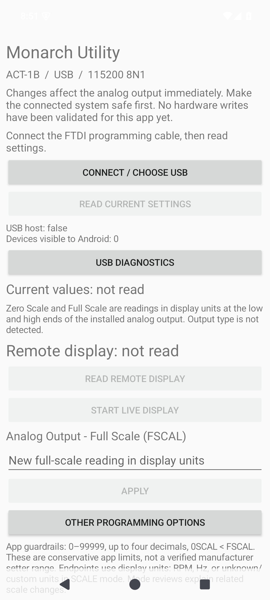
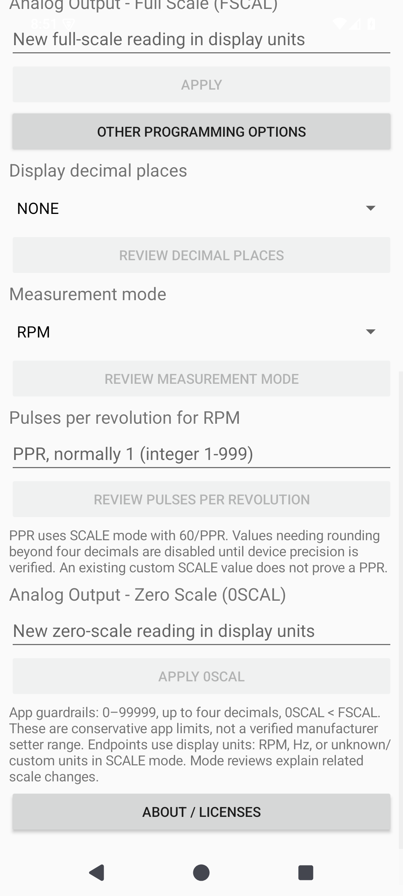
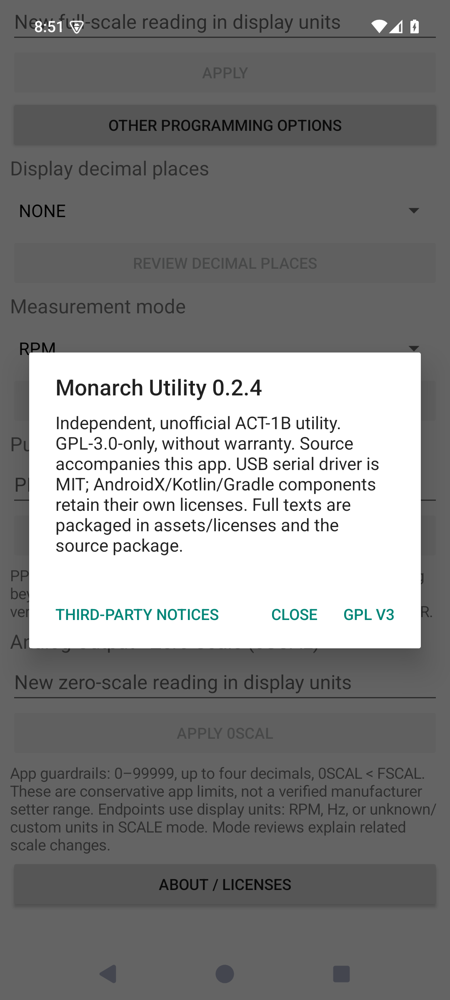

# Monarch USB Android

Independent, unofficial Android USB utility for Monarch ACT-1B panel tachometers. Bench-preview version 0.2.4, GPL-3.0-only. Not affiliated with or endorsed by Monarch Instrument.

## Screenshots

Actual, unmodified screenshots of version 0.2.4 running in an Android 15 emulator, without an attached instrument. No sample device readings are injected. Programming controls remain disabled until a real connection and successful read. These images demonstrate the interface, not USB or hardware write validation.

## Features

- FTDI USB permission/selection and ACT-1B identification.
- Current configuration and full-scale output (FSCAL) workflow first; zero scale remains unchanged unless explicitly edited.
- Reviewed decimal-place choices NONE/1/2/3; RPM/frequency mode; documented SCALE-based pulses-per-revolution conversion.
- Remote display snapshot or approximately 1 Hz polling of @D0. Returned values are already scaled and are not converted again.
- Serialized, allowlisted commands, explicit Apply, acknowledgement/readback and unrelated-setting checks. No automatic retry/rollback. Interrupted writes require reconnect/read before a new decision.

## Requirements and use

Android 8 or later with USB host/OTG; FTDI Monarch programming cable; independently powered ACT-1B. Currently fixed at 115200 baud, 8N1, CR+LF. Manufacturer manual lists default9600, so compatibility depends on actual device configuration. No auto-baud or baud-changing command is sent. No network permission.

Connect, select the cable and grant Android USB permission. Review the current settings. Enter FSCAL and choose Apply to open the confirmation, then Apply to send the change. Other programming options includes zero scale, decimals, mode and PPR. Nothing writes on connect, text entry or Cancel. Make connected equipment safe first; scaling/mode changes affect analog output interpretation.

Read remote display obtains one snapshot. Start live display polls without overlapping queries. Polling stops during setting reviews, in background and when disconnected. Displayed units come from the last configuration read; SCALE-mode units are labeled unknown/custom. Remote data cannot establish whether a physical instrument display is faulty.

## PPR and mode semantics

The official PM Remote manual defines RPM scaling as input frequency multiplied by60/PPR. PPR apply uses SCALE mode then its scale-factor setter. Standard RPM replaces that correction. Frequency means sensor pulses/second, not shaft revolutions/second. Analog endpoint numbers are not automatically converted when mode changes; review their meaning after a mode change.

PPR must be an integer1..999 and its factor must be exact within four decimals. Unsupported repeating/higher-precision factors are refused before I/O, not silently rounded. This is a conservative app restriction, not a claimed instrument limit. Existing custom SCALE values are never automatically labeled as a known PPR.

Endpoint guardrails:0..99999, at most four decimals, zero<full. Setter precision/bounds are not specified in the manufacturer command appendix. RPM/FREQ readback verifies TYPE and displays raw SCALE; firmware raw-SCALE representation is not assumed to equal the manual's effective conversion multiplier.

## Build and tests

Set JAVA_HOME to JDK17/21 and ANDROID_HOME to AndroidSDK35 (Build Tools35.0.0). Run ./gradlew :app:testDebugUnitTest :app:lintDebug :app:assembleDebug, or build.ps1 on Windows. Dependencies are pinned; a fresh build needs access to Google Maven, Maven Central, JitPack and Gradle distributions. APK output:app/build/outputs/apk/debug/app-debug.apk. Development/debug signature only.

Mock tests cover validation, response parsing, ordering, stale/incomplete snapshots, unrelated changes and partial failures without retries/rollback. They do not establish Android USB or physical instrument behavior. Real-phone permissions/lifecycle, byte-stream timing, setters, sensor accuracy, analog output and power-cycle persistence remain unverified. Do not rely on this preview in a safety-critical control system.

## PM Remote coverage

Implemented: identification/configuration, output scaling, decimals, RPM/frequency, restricted exact PPR conversion, remote display.

Not implemented: arbitrary scale entry, display update-rate/gate/low-end/input/pulse-polarity editing, extrema read/reset, local profiles, logging/CSV/Excel, alternate transports or other instrument models. Alarms and a second channel are not ACT-1B features. No undocumented diagnostics, calibration, factory reset or output forcing.

## Sources

- https://monarchserver.com/Files/pdf/manuals/ACT-1B_Panel_Tachometer_Instruction_Manual.pdf
- https://monarchserver.com/Files/pdf/manuals/PM_Remote_Software_Instruction_Manual.pdf

## License

Application source: GNU GPL version3 only, without warranty; see LICENSE. Dependencies retain their original licenses; see THIRD_PARTY_NOTICES.md and licenses/. No manufacturer software, manual PDFs, artwork or device records are included. Test identifiers are synthetic.

## 0.2.1
Adds LL-only launcher branding, FTDI USB-attach registration, unique permission request identifiers, foreground-gated connection and copyable USB diagnostics. Replies may include or omit device command echo. USB diagnostics may contain instrument identifiers and settings: review before sharing. 32 unit tests pass; debug build and lint pass. Emulator installation and cold launch pass, but no physical instrument was connected during these tests. A real phone connection and all setters still need bench verification. The LL mark uses the owner's existing artwork; software licensing does not grant trademark rights.

## 0.2.2: actual ACT-1B configuration delimiters
The hardware log confirmed FTDI 0403:6015 permission and successful 115200 identity/settings/scalar replies. C2 fields contain spaced equals delimiters (for example, 0SCAL = 0.0000). The old parser wrongly treated '=' as the value. Configuration parsing now canonicalizes these delimiters before extracting and comparing fields. Regression tests preserve the actual CR/CRLF and whitespace layout; the public fixture substitutes an anonymous serial number.

Opening now performs one identity query, then C2, zero and full-scale reads in order, instead of redundant identity queries. Readiness is set only after successful complete refresh. The reported failure involved only read commands; no setter was present. Settings still require explicit Review then Apply and retain acknowledgement/readback checks, no retry and no rollback.

37 unit tests pass, including hardware-shaped read-only sequence, equals/no-equals equivalence, SCALE-mode parsing, unrelated-change detection and startup timeout/no-retry. Debug assemble and lint pass. Earlier startup timeouts have no proven cause from the supplied trace; successful later traffic confirms 115200 works. No speculative baud, DTR/RTS, delays or automatic retries were introduced. Physical setters and startup reliability still require bench verification.

## 0.2.3: Apply and voltage endpoint labels
FSCAL's primary button is now Apply. It opens a confirmation with the before/after values; only the confirmation's Apply sends the setting. Current values show 0 V = [0SCAL] and 5 V = [FSCAL], with RPM/Hz or explicitly unknown custom units, and identify this as the 0-5 V AO model mapping. New-value inputs and confirmation use the same meaning.

Verified against official ACT-1B manual section 4.2 and Appendix A: https://monarchserver.com/Files/pdf/manuals/ACT-1B_Panel_Tachometer_Instruction_Manual.pdf . The documented AO option is 0-5 V; the alternative IO hardware is 4-20 mA. No selectable 0-10 V range is documented. USB identity/settings do not establish which option is physically fitted, so the UI includes a rear-output-label check rather than claiming automatic output detection. OUTPT is pulse polarity, not voltage-range selection.

All 40 unit tests passed, including three new presentation tests for dynamic zero/full values and units. Offline debug build and lint passed; no physical device writes were performed. User reported successful 0.2.2 connection and setting reads; this does not validate setters or electrical output.

## 0.2.4: output-neutral PM Remote terminology
Supersedes the voltage-mapping UI introduced in 0.2.3. The app now uses Analog Output, Zero Scale (0SCAL), Full Scale (FSCAL), and readings in display units, without voltage/current endpoint assumptions. Persistent labels identify new-value inputs, while current settings remain read-only and separate. Apply still opens a before/after confirmation before any setting is sent.

Evidence: official PM Remote Software manual, section 3.2 and 3.2.1, printed pages 9-10, including its configuration screenshot, reviewed November 9, 2026: https://monarchserver.com/Files/pdf/manuals/PM_Remote_Software_Instruction_Manual.pdf . Its Analog Output group uses Full Scale and Zero Scale in display units and an Apply action. This app follows that terminology, not a pixel-for-pixel copy or complete feature parity. Output hardware remains unidentified. Existing serialized protocol, full-snapshot checks, readback and no-retry/no-rollback rules are unchanged.

41 unit tests passed; offline debug build and lint passed. Presentation regression test prevents voltage/current assumptions in scaling labels. Source scan found no fixed voltage/current labels in app Java. No physical device commands or writes were issued.
